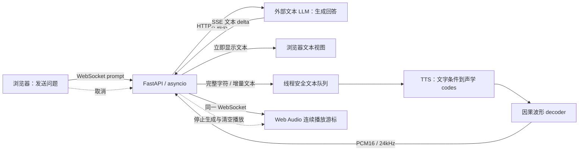
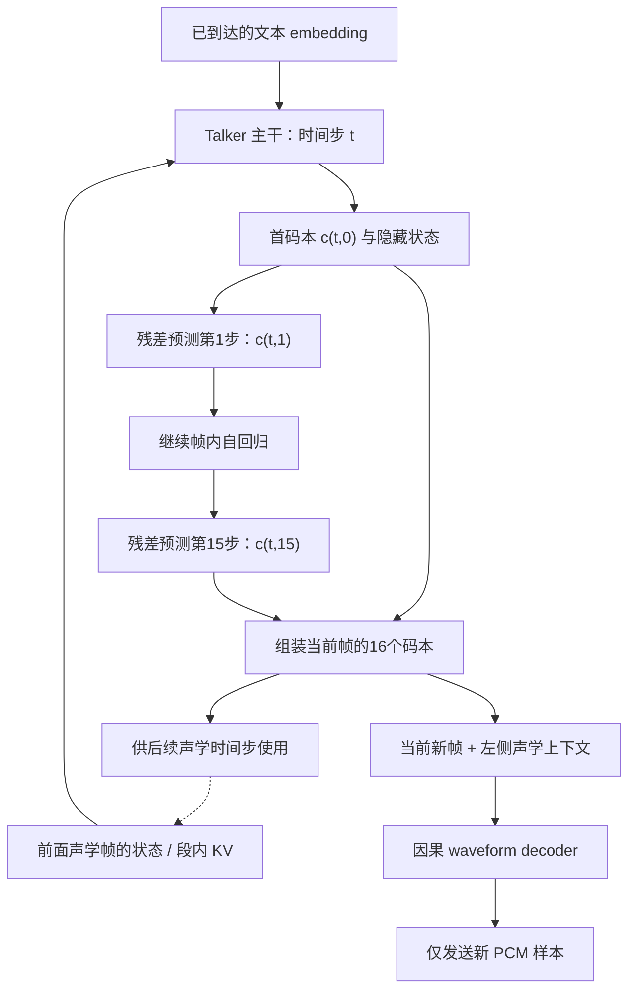
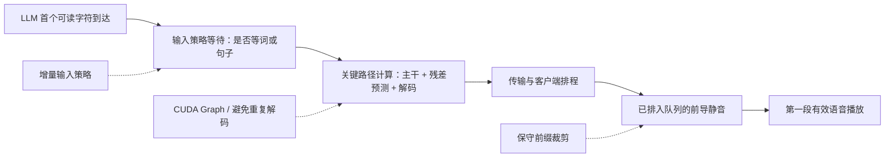
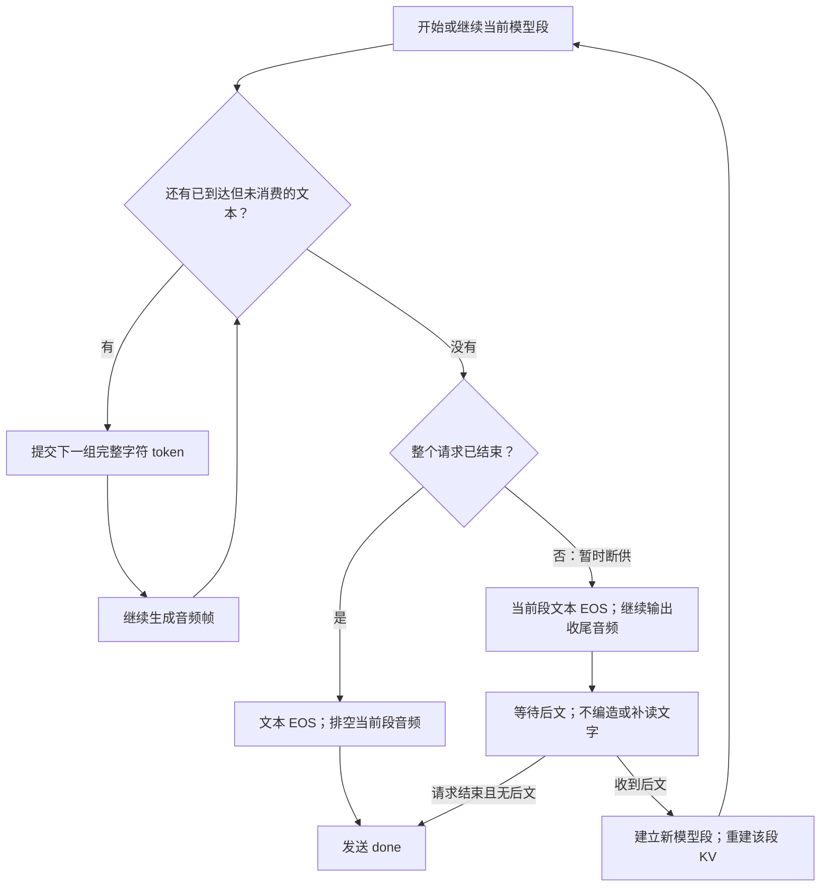

# 从首个可读 token 到出声：一次 Qwen3-TTS 流式链路优化

2026-10-21 · [English](2026-10-21-qwen3-tts-streaming-optimization.en.md)

## 摘要

本文研究一个由独立文本 LLM 与 TTS 串接的低延迟朗读系统。在首个可读字符必须独立启动合成的约束下，我们对现有 `Qwen3-TTS-12Hz-0.6B-CustomVoice` 推理链路进行分析与优化，不改变模型权重。一次同步计时分析显示，残差码本预测占生成耗时约 68%，波形解码约 9%；这构成了优先优化残差预测执行与重复解码的依据。最终采用固定步骤 CUDA Graph、有限左上下文解码与保守的开头静音裁剪，并用延迟后文的试验验证因果输入要求。

固定文本生成时间从 8.415s 降到约 2.80s；一组相同返回文字的浏览器对照中，预计出声从 1513ms 降到 550ms。结果支持该实现对单会话场景有效，但不构成并发服务、音质等价或低于 100ms 全链路延迟的证明。完整代码和复现命令置于文末附录，避免把实现细节与研究动机混在一起。

## 1. 问题定义：到底要优化什么？

设用户希望听到 LLM 正在生成的回答，而不是等回答完成后再朗读。系统同时有两个目标：

- **起音延迟：** 尽早把已知的第一个可读字符变成可播放的正确语音。
- **持续生成能力：** 后续音频生成速度足以跟上播放速度，减少断流。

这两个目标不能用“首包时间”统一替代。一个很早到达但只含静音的包没有改善起音；一个很快开始但持续生成慢于实时的系统仍会卡顿。

约束是：首个可读字符已经到达时，不得为了凑齐词、句子或固定长度文本块而等待后文。这里的字符不是任意一个 tokenizer 字节片段；对中文，需要先构成可读的 Unicode 字符。该约束限制输入策略，并不要求一个文本 token 与一个声学帧一一对应。

### 1.1 为什么不先换一个更小的模型？

实验实际已经使用 0.6B TTS。参数更少可能降低计算量，但不能自动消除句子缓冲、Python 调度、重复前缀解码或生成波形中的静音。换模型还会同时改变音色、对齐和流式输入行为，使延迟差异更难归因。因此本实验先固定权重和音色，定位同一实现内部的可消除开销。模型替换仍然是后续比较项，不是本实验排除的方向。

### 1.2 为什么不直接使用 Qwen-Omni 的 Talker？

这里的输入接口是外部文本 LLM 的离散文本增量，而不是多模态一体模型内部的隐藏状态。把两个系统都称为“Talker”或“MTP”并不意味着它们的输入协议、条件信息和延迟测量起点相同。本文只研究现有独立 TTS 的执行路径；没有把 Omni 的某个延迟数字作为可直接对照的实验结果，也没有声称复现了 Omni 的训练或架构。


## 2. 基础架构与测量对象

[Qwen3-TTS 官方仓库](https://github.com/QwenLM/Qwen3-TTS)提供了本实验使用的 `Qwen3-TTS-12Hz-0.6B-CustomVoice`。我们保留这个模型，在推理和传输路径上优化，没有训练新模型或替换成 Qwen-Omni Talker。

### 2.1 系统层：两个生成模型，而非一个联合语音模型

外部 27B LLM 决定“说什么”；TTS 根据已经到达的文字决定“怎么发声”。Web 服务负责将两者连接，并处理取消与播放。LLM 的文本输出既用于页面显示，也作为 TTS 条件；TTS 不负责生成新的回答内容。



*图1：系统边界。异步文本输入和音频输出可以交错，但 TTS 实例保持单会话；箭头不表示多个 TTS 请求并发执行。*

### 2.2 模型层：时间维自回归与帧内码本自回归

在本配置中，一个声学帧由 16 个码本索引表示。Talker 主干推进声学时间，预测当前帧的首码本，并提供隐藏状态；较小的残差预测器再补齐其余 15 个码本。所有索引共同交给波形 decoder，才能还原声音。

因此，存在两种不同的递归依赖：**声学帧之间的时间依赖**，以及**同一帧内部残差码本之间的依赖**。我们把后者简称 MTP；它不是在预测 15 个未来的文本 token，也不是把 15 个未来声学帧一次性并行生成。



*图2：依赖关系示意，不是完整模块调用图。主干 KV 在一个模型段内跨时间步保留；残差预测的 cache 用于单帧内的15步。两者不能混为一谈。*

一个声学帧对应 1920 个 24kHz 采样，即 80ms 的**音频内容**。这是编码步长，不是计算耗时，也不意味着收到一个字后只生成一帧就足够把它读完。

Web、LLM 和 TTS 在同一台服务器上，TTS 使用一张 RTX 4090 D，LLM 在其他 GPU 上服务。TTS 是单会话实验服务，结果不包含多用户并发排队。主干和 MTP 使用 BF16，最终波形解码器使用 FP32；本次环境为 `qwen-tts 0.1.1`、`transformers 4.57.3`、`torch 2.14.1`，主干使用 SDPA。主要对照使用中文、Vivian 音色和预热后的服务。

### 2.3 测量定义：首包不等于起音

第一包 PCM 不一定包含人声。服务端完成生成也不等于浏览器播放结束。因此我们分别记录：

| 指标 | 起点与终点 |
| --- | --- |
| 首文字 | 点击发送 → 收到首个 LLM 文本 delta |
| 首 PCM | 点击发送 → 收到首个 PCM 二进制包 |
| 首有效音频包 | 点击发送 → 收到包含非静音采样的 PCM 包 |
| 预计出声 | 根据首个非静音采样在包内的位置、Web Audio 排程和可用 `outputLatency` 估算 |
| 生成完成 | 点击发送 → 收到服务端 `done` |
| 播放断流 | 后续音频到达时，播放游标已经落后于音频时钟的累计时长 |

“预计出声”不是麦克风测出的物理扬声器起音。检测非静音使用绝对振幅阈值，它也不等于自动判断“这里一定是正确的人声”。后面还需要首字截取和 ASR 校验。

## 3. 瓶颈定位与优化假设

### 3.1 从观测到干预，而不是先选优化工具

先在固定文本、预热后的单会话运行中，对残差预测器和 decoder 的调用前后同步 CUDA 并计时。该次运行生成 6.64s 音频，用时 8.357s。原始汇总见[基线 profiling 数据](qwen3-tts-streaming-repro/baseline-profile.json)。

| 计时区域 | 调用次数 | 累计耗时 | 占本次总耗时 |
| --- | ---: | ---: | ---: |
| 残差码本预测 | 83 | 5.681s | 67.98% |
| 波形解码 | 25 | 0.772s | 9.23% |
| 其余路径（总时间减上述两项） | — | 1.904s | 22.79% |

残差预测每次调用的中位数为 68.30ms。这份结果是带同步的函数区域计时，不是 CUDA kernel trace；无法仅凭它断言 68% 全部来自 CPU 调度。它告诉我们“时间花在哪里”，随后通过改变执行方式并测量结果，检验“哪些时间可以减少”。其余22.79%也不能全部归为主干计算，里面还包括适配、采样和 Python 开销。

这与固定文本端到端基线8.415s是不同测量，不能混成同一条记录。只看吞吐，这次 profiling 的实时因子 `RTF = 8.357 / 6.64 ≈ 1.26`，表明无额外缓冲时持续播放有断流风险。

### 3.2 三类延迟，分别处理



*图3：延迟来源与干预位置。此图是因果分解，不是按比例的时间线；生成与播放可重叠，各框不应直接按独立测量值相加。前导静音既可能消耗生成步骤，也会占用播放时间，裁剪只消除后者。*

| 观测 / 约束 | 假设 | 选择的干预 | 必须保留的性质 |
| --- | --- | --- | --- |
| 不允许等完整词句 | 文本聚合策略本身会引入额外等待 | 队列按已知字符推进，断供时分段收尾 | 后文到达前能独立读出首字 |
| 残差预测约占68% | 固定小步骤反复进入通用生成路径，存在可压缩的调度开销 | 捕获15步残差预测 graph | 保留自回归依赖和采样设置 |
| 重复解码整个前缀 | 音频越长，已经发送的历史被反复计算越多 | 有限左上下文 + graph 桶 | 不发送上下文或 padding，不依赖未来帧 |
| 第一包早到但人声晚 | 波形里存在低振幅前缀 | 仅裁请求开头，保留40ms前沿 | 不截断弱起音，不以静音包冒充人声 |

按这次计时做一个理想化 Amdahl 检查：若只优化占比约0.68的残差区域、其他区域不变，即使把该区域耗时降为零，总加速上限也只有 `1 / (1 - 0.68) ≈ 3.1`。这不是性能预测；它说明残差路径值得优先做，但仅优化这一处不能无限降低延迟，decoder和播放路径仍需单独分析。

### 3.3 为什么选择这些方法？

主干并非不值得优化，而是本次计时没有把它单独证明为最大瓶颈。与其先改变注意力内核、权重精度或模型规模，我们选择占比高、步骤固定、容易逐帧对照的残差路径作为第一干预点。动态 batching 主要服务吞吐与资源利用率，本实验关注单会话起音，主动等待更多请求或更多文本会改变目标，故未将其引入。

**CUDA Graph 的适用性来自工作负载形状。** 单会话、batch=1、固定15步残差循环，使输入形状和执行路径足够稳定，适合捕获。它减少重复提交开销，不减少模型参数，也不消除帧内自回归。若调度并非主要开销，graph收益就会变小，必须以实际运行检验。

**有限上下文针对重复工作，graph桶针对执行开销。** 两个动机不同：前者限制每次重新解码的历史长度，后者让变化长度落入少量固定形状。对于逐帧调用，反复计算长度为1、2、…、N的前缀会累计处理 `1+2+…+N` 个输入帧；固定左窗口则只处理有界历史。这只是重复输入量的说明，不是对具体 decoder 总复杂度的严格证明。

**静音裁剪是输出策略，不是模型加速。** 在生成出的第一个有效声学片段之前，GPU仍要完成相应步骤；裁剪的作用是避免浏览器再把这段低振幅前缀播放一遍。把两种收益分开，才能避免“首PCM很快”造成的误判。


## 4. 方法：按瓶颈位置实施干预

### 4.1 输入策略：让增量文本进入合成过程

输入流式和输出流式是两件事。把一段已经生成完的音频拆成小包，只解决了输出传输，不能证明模型接受了尚未结束的文本。

适配层在音频生成步中，从队列取下一份文本 embedding。没有读过的文字可以重新一起分词，已经送入模型的 token 不会回退重写。处理中文时还要考虑 tokenizer 的字节片段：根据 offset 把覆盖首个完整字符的片段一起提交，避免只交出半个字符或丢掉余下片段。

文字暂时断供时，最终实现选择：

1. 给当前模型段发送文本结束标记，让模型完成已知内容的音频。
2. 已生成的音频继续输出，不阻塞正在播放的内容。
3. 后文到达后，在同一个 WebSocket 会话内开始下一模型段。

KV cache 在段内保留，段间重建。这一点非常重要：它不是一个能无限等待新文字、永远不断开的 Omni Talker 状态。

如果只知道“你”，读完以后仍然没有后文，那么系统应当停顿。**不能同时要求不等后文、一直有声、又绝不猜测内容。** 这里的首 token 目标是“不依赖后文就能开始正确朗读已知字符”，不是“计算时间为零”。

### 4.1.1 文字断供时的状态转换



*图4：默认 segment 策略。图中“等待后文”发生在当前已知内容完成之后；不会为了未来文字推迟首字合成。队列可以在当前段收尾时接收文字，下一段再消费。*


### 4.2 MTP 执行：捕获固定残差预测循环

这里把残差码本预测器简称为 MTP。主干生成首码本之后，当前配置还需要预测 15 个残差码本 token。优化的是这些固定步骤的执行方式，而不是让 15 个自回归依赖突然变成并行预测。

实现采用带 KV cache 的 CUDA Graph：

- 预分配固定形状输入、位置张量和输出缓冲区。
- 按模型实际依赖展开 15 步，首步使用 embedding，后续步骤使用上一步 token。
- 捕获并保留 graph、cache 所需张量和输出缓冲区；每次复制新的 Talker 隐状态，再 replay。
- 保留 top-k 50、temperature 0.9、top-p 1.0 的采样设置。

这种方法减少 Python 调度和通用 `generate()` 路径的重复开销。固定形状只是必要条件，cache、位置编码、张量生命周期也必须正确。

我们没有用随机张量上的“能跑通”作为验收。服务启动时取 **32 个真实 Talker 输入**，把 graph 的 greedy 输出与 upstream greedy 输出逐帧比较，要求完全一致，否则不接受请求。这个检查不意味着采样模式逐帧完全一致：CUDA Graph 下的随机数消耗顺序可能变化，同一个 seed 也不是声音逐样本相同的保证。

### 4.3 波形解码：限制重复历史并捕获固定桶

原有路径反复解码整个音频前缀，再截取没有发过的部分。越往后，重复计算越多。

最终路径保留 25 帧左上下文，只解码这段上下文加新帧，采用 8、16、32 帧的 CUDA Graph 桶。超出桶范围时回退到普通解码。每帧对应 1920 个 24kHz 采样，即 80ms 的音频内容；这不是计算该帧必须花费 80ms。

首个可听内容出现前逐帧尝试解码，之后默认每 4 帧输出一块；因此没有为了凑齐一个 4 帧音频块而主动推迟起音。这个策略也解释了为什么首包延迟、后续吞吐与播放断流需要分别测量。

对新波形的裁切可写成如下示意：

```python
sent_frames = samples_sent // 1920
start = max(0, sent_frames - 25)
selected = codes[start:]
wave = decode_with_bucket(selected)
new_pcm = wave[(sent_frames - start) * 1920 : len(selected) * 1920]
```

这不是完整可运行实现。关键是：左上下文不重复发送，桶的右侧 padding 不发送，也不需要未来文字。

BF16 解码在不同输入长度下出现了明显数值偏差，因此没有坚持“所有模块都必须半精度”。最终只把波形 decoder 改为 FP32，仍使用 CUDA Graph。启动时 8 次真实帧对照中，与相同左上下文的普通 decoder 相比，最大绝对误差约 **0.000653**，低于设定的 0.003 阈值。

这是限定样本、限定上下文的数值检查，不是对所有长度的音质等价证明。修改窗口长度或 decoder 后仍需重新检查边界。

### 4.4 输出策略：定位并裁剪前导静音

同一固定输入在原版、仅 MTP 加速、再加解码加速三个版本里，波形绝对振幅首次超过 0.001 都出现在约 **365ms 的音频位置**。这说明该样本的主要前导静音已经存在于模型生成的波形中，而不是浏览器先缓冲了 365ms。

我们只处理每个请求的开头：累积已生成的低振幅前缀，找到超过阈值的位置后，保留起音前 40ms，把更早的部分裁掉。固定文本裁掉约 325ms；浏览器对照那一轮裁掉 353ms。后面的自然停顿不做同样裁剪。

裁剪不会让模型提前算出还没生成的声音。真正的收益来自两部分：模型更快地产生有效帧，以及播放队列不再先播放这段静音。保留前沿余量有助于避免损伤弱起音，但振幅门限仍是启发式，需要用不同首字和音色验证。

### 4.5 传输与播放：连续排程及取消

服务端把 LLM delta 同时送到页面和 TTS 队列，文本不是等语音完成才显示。音频元数据和 PCM 二进制包经过同一个 WebSocket，客户端校验请求归属后排入 Web Audio。

播放器维护连续游标，而不是每个包到达就立刻启动一个独立片段：

```javascript
const when = Math.max(cursor, audioContext.currentTime + 0.012);
source.start(when);
cursor = when + buffer.duration;
```

12ms 是本次实现的调度余量，不是通用最优值。停止操作同时清空本地音频、丢弃迟到包、取消远端生成，并释放单会话锁。否则下一次测试可能测到上一轮遗留的音频或排队。

后来添加的九音色选择只改变请求里的 speaker，共用原有流式和 graph 路径。内网 HTTP 访问还暴露了 `crypto.randomUUID()` 不可用的问题；请求关联 ID 增加时间戳加页面内序号的兼容分支。这个 ID 不用于认证，不能把这种回退用于安全 token。

## 5. 实验结果与归因边界

浏览器测试使用相同问题“请用两句话介绍一下杭州适合散步的地方”，前后返回文字相同：

| 指标 | 优化前 | 优化后 |
| --- | ---: | ---: |
| 首文字 | 697ms | 265ms |
| 首 PCM | 861ms（含静音） | 453ms |
| 预计出声 | 1513ms | 550ms |
| 首文字 → 预计出声 | 816ms | 285ms |
| 生成完成 | 22.123s | 7.216s |
| 音频长度 | 16.80s | 16.45s |
| 播放断流累计 | 4044ms | 0ms |

这里 LLM 的首字也变快了，不能把全部端到端差值归因于 TTS。这是各一轮前后对照，不是 p50/p95。

因此另用固定文本、seed 42 测 TTS：

> 你好，欢迎测试。今天我们测试首字朗读和持续音频生成的速度。

| 指标 | 原版 | 最终版第1轮 | 最终版第2轮 |
| --- | ---: | ---: | ---: |
| 生成耗时 | 8.415s | 2.803s | 2.794s |
| 首有效音频包 | 634ms | 183ms | 189ms |
| 预计起音 | 682ms | 226ms | 231ms |
| 输出音频长度 | 6.640s | 6.315s | 6.315s |

生成速度约提高 3 倍。输出长度减少主要对应开头约 325ms 的裁剪；固定文本最终版的播放模拟仍有约 58ms 短缺口，因此不能用浏览器那轮的 0ms 宣称“任何场景都没有断流”。

### 5.1 可以归因到哪里，不能归因到哪里？

固定文本对照排除了 LLM 首字变化，但最终版本同时改变了残差执行、decoder执行/精度和前缀裁剪。因此约3倍加速是**组合方案的结果**，不能把它当作“CUDA Graph 单独提升3倍”的证据。函数计时支持优化优先级，却不能替代完整消融实验。

要进一步量化各因素，应在相同硬件、文本、采样配置与输入节奏下比较普通路径、仅残差graph、再加入窗口解码、再加入decoder graph、最后加入裁剪；同时记录起音、完整生成时间、RTF和转写差异。本次未完成覆盖所有因素的严格重复消融，本文不为每个因素单独给出因果增益。

## 6. 因果输入与内容完整性验证

最直接的方法是故意不给后文。四轮分别先给“你”“你”“我”“请”，后文延迟 2、2、5、2 秒。首有效音频包约在 219、252、218、218ms 到达。

我们只截取**第二份文本到达之前已经收到的音频**，再做 ASR，结果分别为“你”“你”“我”“请”。这样可以避免把收到后文之后才生成的声音误当作首字能力。

最终回归包含 13 个场景（其中一个是等待后文的对照）和 4 份首字截取，共 17 份 ASR 校验：

- 15 份逐字相同。
- 两份分别出现“先→仙”“步→不”的同音字替换。
- 没有 ASR 检出的删除或插入。

另有三轮真实 LLM 流式输出逐字对齐。部署后 `/chat` 两轮完整录音中，一轮逐字相同，一轮为“胜地→圣地”的同音替换，未检出漏读或重复。取消、断开、等待期间取消与断开均能释放会话，同连接取消后复用也通过。

ASR 可能漏掉或误判发音问题，因此这些结果只是验收证据，不等于真人听感评价，更不是任意输入的零错误保证。

## 7. 失败尝试与设计取舍

早期加速候选曾产生额外语音。为了稳定收尾，我们试过全 greedy，也试过只在碎片化请求结束后使用确定性尾部；这两种改动又出现了漏读，因此撤回。最终部署保留原采样方式，仅优化执行和解码。

这说明“更快结束”和“完整读完”不是同一个目标。缩短尾音、强制 EOS 或改变采样都可能让延迟指标好看，却破坏内容。优化过程必须同时保存文本、事件和完整音频，不能只看首包时间。

## 8. 局限与后续实验

这次结果支持继续使用当前路径，但还有明确的验证空白：更广的首音素与多语言输入、九音色的完整性回归、不同网络抖动、长文本、并发排队，以及冷启动与 p95 延迟。25 帧上下文和静音阈值也需要更广的音质检查。

最值得保留的方法是：把首包与真实起音分开，把 LLM 延迟与 TTS 耗时分开，用延迟后文验证输入流式，用完整音频验证内容，再决定是否部署。**本次加速把链路推进到了数百毫秒起音，而不是已经实现了低于 100ms 的全链路语音交互。**

## 附录 A：框架版本、实现细节与复现命令

现在提供[复现实验目录](qwen3-tts-streaming-repro/README.md)，包含完整的推理适配器、CUDA Graph 实现、FastAPI 服务、浏览器页面和基准客户端；不再只有伪代码。可先不接 LLM，仅用 `/ws` 跑固定文本，再接 `/chat` 测端到端。

| 层 | 实际实现与版本 |
| --- | --- |
| 操作系统与 GPU | Ubuntu 22.04.1、RTX 4090 D 24GB、NVIDIA driver 580.126.20 |
| Python | CPython 3.11.12 |
| 张量计算 | PyTorch 2.14.1，编译 CUDA 13.0，cuDNN 9.24 |
| TTS 包 | qwen-tts 0.1.1 |
| 生成框架 | Transformers 4.57.3、accelerate 1.12.0、tokenizers 0.22.2 |
| HTTP / WebSocket 服务 | FastAPI 0.151.0、Uvicorn 0.54.0，单 worker |
| 客户端传输 | HTTPX 0.28.1、websockets 17.3 |
| 数值与音频文件 | NumPy 2.4.6、soundfile 0.14.0 |

TTS 路径使用原生 PyTorch 和 Transformers，**没有使用 vLLM、SGLang、TensorRT、`torch.compile`、量化或新训练**。注意力实现是 SDPA；CUDA Graph 加速的是残差预测器和波形 decoder，Talker 主干仍走普通生成路径。Web 前端是原生 JavaScript，没有构建步骤。

[完整依赖快照](qwen3-tts-streaming-repro/requirements-observed.txt)来自已运行环境，而不是重新求解的 lockfile。特别是环境里的 torchaudio 为 2.11.0，与 torch 版本不一致；不能据此推断这是一组推荐的二进制兼容版本。完整快照的全新环境安装尚未验证，已从下载缓存的13份元数据（含两个权重文件）核对模型 revision 为 `85e237c12c027371202489a0ec509ded67b5e4b5`。下面命令固定该版本，但仍不承诺跨环境逐 bit 相同的声音。

### 快速复现顺序

```bash
git clone https://github.com/strike20023/strike20023.github.io.git
cd strike20023.github.io/blogs/qwen3-tts-streaming-repro
uv venv --python 3.11.12 .venv
source .venv/bin/activate
uv pip install -r requirements-observed.txt

hf download Qwen/Qwen3-TTS-12Hz-0.6B-CustomVoice \
  --revision 85e237c12c027371202489a0ec509ded67b5e4b5 \
  --local-dir ./models/Qwen3-TTS-12Hz-0.6B-CustomVoice
export MODEL="$PWD/models/Qwen3-TTS-12Hz-0.6B-CustomVoice"
export CUDA_VISIBLE_DEVICES=0
python -m unittest test_queue -v
FAST_INFERENCE=1 TRIM_LEADING_SILENCE=1 bash run.sh
```

如果依赖求解失败，见复现目录中对已安装快照、`--no-deps` 和匹配 torch/torchaudio 版本的说明；不要静默升级后仍把结果标成原环境复现。服务启动自检不通过时，也不要删除断言继续跑。

另开终端，在相同环境、相同目录运行：

```bash
# 不经过 LLM，先隔离 TTS；输出完整 WAV 和逐事件 JSON。
python bench.py --mode full --runs 3 --seed 42 --chunk-frames 4 \
  --text '你好，欢迎测试。今天我们测试首字朗读和持续音频生成的速度。' \
  --output outputs/fast-fixed

# 只先发“我”，五秒后才发后文。
python bench.py --mode hold --delay 5 --seed 44 \
  --text '我喜欢读书，也喜欢听音乐。' --output outputs/hold
python check_prefix.py outputs/hold
```

对照必须分进程：停止服务后以 `FAST_INFERENCE=0 bash run.sh` 启动，再跑同一组命令、写入新的输出目录。丢弃未预热的测量轮。该 baseline 同时关闭 graph 和开头静音裁剪；增加 `FAST_INFERENCE=1 TRIM_LEADING_SILENCE=0` 的第三组，才能进一步分离计算加速和静音裁剪的收益。

接 LLM 时，在启动服务前设置 `LLM_URL` 为完整的 OpenAI 兼容 chat-completions URL、`LLM_MODEL` 为服务中的模型名，需要鉴权时通过 `LLM_API_KEY` 环境变量传入。页面位于 `http://127.0.0.1:8092/`。不同 LLM 能复现连接方式，但不能复现本文的 LLM 延迟。若服务不接受 `chat_template_kwargs`，应移除这个模型专用参数。复现包不包含 ASR 服务；首字和全文的 ASR 需另外提供，原评估使用 Qwen3-ASR-1.7B。

### 从函数看实现细节

**输入适配：** [`install_adapter()`](qwen3-tts-streaming-repro/streaming.py) 通过 `inspect.getsource` 获取当前安装包的 Talker `forward`，在已断言存在的文本 embedding 分支插入队列消费逻辑，再把新方法绑定到模型实例；没有修改 site-packages。这个方法依赖确切源码结构，升级 qwen-tts/Transformers 后需要重新核查。尚未给当前段提供文本 EOS 时屏蔽 codec EOS，避免模型在已知文字未消费完时结束；`pending`、未读字符串和队列终止标记必须分开处理。

**MTP 缓冲与位置：** [`install_mtp()`](qwen3-tts-streaming-repro/fast_inference.py) 的静态输入形状为 `[1, 2, talker_hidden_size]`。首步位置是 `[0,1]`，随后第 `i` 个残差步使用位置 `[i+1]`，`generation_steps=i` 决定相应预测步骤。`DynamicCache` 在捕获的一个音频帧残差序列内使用，不是跨音频帧无限累积的 cache。greedy 和 sampling 分别捕获 graph；sampling 在 GPU 上做温度缩放、top-k 截断、softmax 和 multinomial。replay 后复制输出，避免后一次 replay 覆盖尚在使用的结果。

**捕获与执行：** 先在独立 CUDA stream 上预热，再与当前 stream 同步，随后捕获。不能把 graph 当作普通无状态函数：它引用固定缓冲区，所以服务用锁限制单会话、Uvicorn 固定一个 worker。开启多个推理线程共享这些 buffers 会互相覆盖输入输出，不能直接用它测试并发吞吐。

**解码与计数：** codes 转成 `[1, num_quantizers, frames]`，挑最小可容纳的桶，清零缓冲区、拷贝实际帧、replay。`samples_sent` 计算的是未裁静音前的模型采样数；发往浏览器的样本数可以更少。混用两个计数会导致后续波形切片错位，表现为漏音或重复。

**线程与事件循环：** [`web_chat.py`](qwen3-tts-streaming-repro/web_chat.py) 用 HTTPX 异步读取 LLM SSE，独立 Python 线程执行 GPU 推理；推理事件通过 `loop.call_soon_threadsafe` 送入 asyncio 队列。这里的异步是让文本输入、推理和传输能够交错进行，不是并发运行多个 TTS 请求。

### 复现时应看到什么

服务启动应出现 `MTP: 32 real Talker inputs matched upstream greedy` 和 codec 对照日志，随后才开始接受请求。固定文本测试应产生 `full-*.wav/json`；严格首字测试应产生 `hold-0-prefix.wav`，且其中应能识别出“我”。不要仅凭 `/health` 成功或 prefix 文件非空判定通过。

`bench.py` 的 summary 从 WebSocket 建立后的 `request_start` 计时，播放模拟从首 PCM 开始，不含浏览器的 12ms 排程余量和物理输出延迟。因此客户端基准的预计起音与浏览器显示值不能直接当作同一个指标。

*数据说明：本文数字来自 2026-10-21 的单会话实验记录。公开文章与复现目录包含服务及基准源码，不附内部服务地址、会话日志或模型权重；完整依赖快照的全新安装尚未验证，具体复现边界见目录说明。*

复现代码独立进程复测：固定文本生成 2.778s，首有效 PCM 199ms；后文延迟5秒时首有效 PCM 217ms，截取首字ASR为“我”，全文对齐。复用了原安装环境，尚未验证全新依赖安装。详见[机器可读结果](qwen3-tts-streaming-repro/validation-result.json)。
