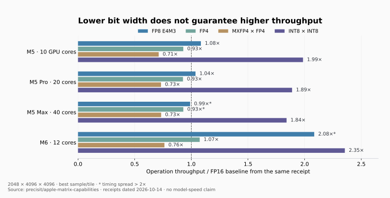

**Mac GPU 的计算能力在 M5 这一代出现了明显分界：M1–M4 的大矩阵通常仍落在普通 GPU 算术吞吐的量级，M5 的 GPU Neural Accelerators 则显著提高了 FP16、BF16 和整数矩阵吞吐。低比特浮点没有同样整齐的增长规律：FP8、FP4、MXFP4 必须分别看测试。**[^apple-nax][^rigel][^matrix]

先看几个有实际报告的数字：M2 Ultra 76 核的 PyTorch FP32 GEMM 约 **20 TFLOPS**；M4 Max 40 核的 FP16 GEMM 约 **13.29–14.80 TFLOPS**，取决于库与测试；M5 Max 40 核的矩阵探针达到 **62.587 BF16 TFLOPS、115.094 INT8 TOPS**，但同一项目的 MXFP4 路径只有 **37.953 TFLOPS**。这几个数已经说明，“位数减半，算力翻倍”不能直接套在 Apple GPU 上。[^device][^rigel][^matrix]

资料截止 **2026 年 10 月 28 日**。覆盖零售 Mac 的 **21 个芯片名称、41 种 GPU 核数配置**；同一 GPU 的不同 CPU、内存和 SSD 组合不重复计数。实测均注明公开报告来源，本文未在这些机器上重新运行。

## 1. 全型号的计算规模与带宽

下表给出所有配置的 **FP32 参考量级**。`T` 是源研究列出的理论吞吐，`E` 是按注明假设计算的参考值，`M` 是原作者实测。它们没有混成一张实测排行榜。斜线左右与 GPU 核数一一对应；带宽为规格值，单位 GB/s。

| 芯片 | GPU 核数 | FP32 参考量级（TFLOPS） | 内存带宽 | 参考依据 |
| --- | ---: | ---: | ---: | --- |
| M1 | 7 / 8 | E 2.29 / T 2.62 | 68 | 1.278 GHz，Turner |
| M1 Pro | 14 / 16 | E 4.64 / T 5.31 | 200 | 1.296 GHz，Turner |
| M1 Max | 24 / 32 | E 7.96 / T 10.62 | 400 | 1.296 GHz，Turner |
| M1 Ultra | 48 / 64 | E 15.93 / T 21.23 | 800 | 1.296 GHz，Turner |
| M2 | 8 / 10 | E 2.86 / T 3.58 | 100 | 1.398 GHz，Turner |
| M2 Pro | 16 / 19 | E 5.73 / T 6.80 | 200 | 1.398 GHz，Turner |
| M2 Max | 30 / 38 | E 10.74 / T 13.60 | 400 | 1.398 GHz，Turner |
| M2 Ultra | 60 / 76 | E 21.47 / E 27.20 | 800 | 按 M2 每核吞吐推算 |
| M3 | 8 / 10 | E 2.83 / E 3.53 | 100 | 1.380 GHz 参考模型 |
| M3 Pro | 14 / 18 | E 4.95 / E 6.36 | 150 | 1.380 GHz 参考模型 |
| M3 Max | 30 / 40 | E 10.60 / E 14.13 | 300 / 400 | 1.380 GHz 参考模型 |
| M3 Ultra | 60 / 80 | E 21.20 / E 28.26 | 800 | 按 M3 Max 每核吞吐推算 |
| M4 | 8 / 10 | E 3.23 / E 4.04 | 120 | 1.578 GHz 参考模型 |
| M4 Pro | 16 / 20 | E 6.46 / E 8.08 | 273 | 同代、同参考频率推算 |
| M4 Max | 32 / 40 | E 12.93 / E 16.16 | 410 / 546 | 同代、同参考频率推算 |
| M5 | 8 / 10 | E 3.32 / E 4.15 | 153 | 1.620 GHz 参考模型 |
| M5 Pro | 16 / 20 | E 6.64 / E 8.29 | 307 | 同代、同参考频率推算 |
| M5 Max | 32 / 40 | E 13.27 / E 16.59 | 460 / 614 | 1.620 GHz 参考模型 |
| M5 Ultra | 64 / 80 | E 26.54 / E 33.18 | 约 1,200 | 按 M5 Max 每核吞吐推算 |
| M6 | 10 / 12 | E 3.65 / M 4.38 | 170 | 12 核 FMA 实测；10 核按比例折算 |
| A18 Pro（MacBook Neo） | 5 | E 1.91 | 60 | 1.490 GHz、5 核参考模型 |

### 这些数字怎样复算

M1/M2 的基础数据来自 Philip Turner 的指令微基准与微架构记录。该研究给出的 **FP16 与 FP32 理论吞吐相同**，所以 M1 Max 32 核在这个口径下为两者各约 10.62 TFLOPS，M2 Max 38 核为各约 13.60；不能把这些芯片的 FP16 自动写成两倍。[^turner]

M3–M5 的 `E` 使用下式，而不是把网页上互相冲突的 TFLOPS 数字拼在一起：

```text
FP32 TFLOPS = GPU 核数 × 128 个 FP32 ALU/核 × 2 FLOP/FMA × 参考频率(GHz) ÷ 1000
```

**这是指定频率下的架构估算，不是 Apple 承诺的峰值，也不是每个 SKU 的频率实测。** M3 的 1.380 GHz 有 M3 Pro 评测与 M3 Max 用户的 `powermetrics` 记录；M4 的 1.578 GHz 来自 10 核 M4 的设备树 P-state 读取；M5 的 1.620 GHz 来自 40 核 M5 Max 的功耗/频率扫描。将这些频率推广到同代其他配置，是表中明确标为 `E` 的假设。实际频率相差 10%，公式结果也相差 10%。[^m3-clock][^m3max-clock][^m4-clock][^m5-clock]

M6 12 核另有直接 FMA 测量：FP32 **4.38**、FP16 **8.46 TFLOPS**；表中 10 核数字只是 `4.38×10/12` 的折算。MacBook Neo 的 1.91 则来自针对其 **5 核**配置的计算，未套用 iPhone 的完整 6 核结果。[^m6-fft][^neo-test]

核心数与带宽以 Apple 规格为准：M1/M2 各代 Pro、Max、Ultra；M3 Pro/Max/Ultra；M4 Pro/Max；M5 Air、Pro、Max、Ultra；M6 与 MacBook Neo。[^sku-m1][^sku-m1studio][^sku-m2][^sku-m2studio][^sku-m3][^sku-m3studio][^sku-m4][^sku-m5][^sku-m5air][^sku-m5studio][^m6][^imac-m6][^neo] M4 Ultra、M6 Pro/Max/Ultra 不在已发布型号清单。2020 年开发者过渡套件 A12Z 不计入零售 Mac；作为历史补充，其 8 核理论吞吐为 FP32 1.155、FP16 2.310 TFLOPS。[^turner]

## 2. M1–M4：已经能查到哪些矩阵实测

浮点均以 TFLOPS 计，GEMM 按 `2MNK` 计数。这里先列矩阵乘法，再列标量微基准；同一 GPU 在两类测试里的数字差异很大。

### 2.1 FP32 与 FP16 GEMM

| GPU / 配置 | 精度 | 吞吐 | 测试与来源 |
| --- | --- | ---: | --- |
| M1，论文测试机 | FP32 | 1.36 | MPS，矩阵尺寸扫描最佳值[^hpc] |
| M1 Pro，16 核 | FP32 / FP16 | 3.70 / 4.30 | PyTorch MPS，公开脚本[^device] |
| M2，论文测试机 | FP32 | 2.24 | MPS，矩阵尺寸扫描最佳值[^hpc] |
| M2 Ultra，76 核 | FP32 | 20.00 | PyTorch MPS，公开脚本[^device] |
| M2 Ultra，76 核 | FP16 | 17.88 | tensorcore，4096³，7.69 ms，中位数[^tensorcore] |
| M3，论文测试机 | FP32 | 2.47 | MPS，矩阵尺寸扫描最佳值[^hpc] |
| M3 Max，40 核 | FP32 | 11.40 | PyTorch MPS[^device] |
| M4，论文测试机 | FP32 | 2.90 | MPS，矩阵尺寸扫描最佳值[^hpc] |
| M4 Pro，20 核、48GB | FP32 / FP16 | 6.528 / 7.349 | MLX，4096³[^mlx-m4pro] |
| M4 Pro，20 核、48GB | FP32 / FP16 | 6.262 / 7.447 | MLX，8192³[^mlx-m4pro] |
| M4 Max，40 核、128GB | FP32 / FP16 | 13.27 / 13.29 | PyTorch MPS[^device] |
| M4 Max，40 核、64GB | FP16 | 14.80 | Rigel，Metal 4.1 MPP，2048³，300 次采样中位数[^rigel] |

这些结果不能直接拼成跨代排行榜：不同作者使用了不同系统、库、矩阵和计时方法。但它们足以限定实际量级。例如 M4 Max 的两个独立矩阵报告都落在十几 TFLOPS，而不是仅凭“FP16”就宣称几十甚至上百 TFLOPS。`device-benchmarks` 的脚本在 `torch.matmul` 前后调用 GPU synchronize，并扫描矩阵尺寸；这是可以审查计时口径的报告。[^device]

同一硬件的库实现也可能造成数量级差异：tensorcore 的 M2 Ultra 4096³ FP32 只有 **2.46 TFLOPS**，FP16 却为 **17.88**；另一项目的 MPS FP32 达到 **20**。因此 2.46 说明的是该实现的 FP32 路径效率，不能作为 M2 Ultra 的硬件上限。[^tensorcore][^device]

还有一个覆盖裁剪配置的独立参照：Magic GPU Benchmark 的矩阵子项报告 M1 7/8 核为 **2.152/2.469**、M1 Max 24 核 **7.384**、M2 Max 30 核 **10.014**、M3 Pro 18 核 **6.260**、M4 Pro 16 核 **6.382**，单位为每秒万亿次操作。这些是该应用的矩阵子项吞吐，页面没有完整说明精度与累加类型，因此不冒充 FP16/BF16 数据；它们仍是核对常见配置计算规模的有效旁证。[^magic]

### 2.2 BF16：MLX 与 MPS 的直接对照

BF16 矩阵在早期 Mac 上可以运行，但格式转换、库实现和矩阵形状会影响吞吐。以下是带具体测试内容的报告：

| GPU / 配置 | BF16 TFLOPS | 路径与条件 |
| --- | ---: | --- |
| M1 Pro，16GB；GPU 核数未注明 | 3.429 | MLX，8192×8192 矩阵测试[^bf16-community] |
| 同一台 M1 Pro | 2.315 | PyTorch MPS，同一作者测试[^bf16-community] |
| M1 Ultra；GPU 核数未注明 | 10.8 | 8192³ 持续矩阵循环，GPU 活跃率 97–100%，作者记录 68W[^m1ultra-bf16] |
| M2 Max，64GB；GPU 核数未注明 | 6.984 | MLX，8192×8192 矩阵测试[^bf16-community] |
| 同一台 M2 Max | 4.796 | PyTorch MPS，同一作者测试[^bf16-community] |
| M3 Ultra，512GB | 21.75 | MLX 0.31.x，量化矩阵问题报告中的 BF16 GEMM 基线[^mlx-qmm] |
| M3 Ultra；GPU 核数未注明 | 25.6 | PyTorch 2.9.0/MPS，3375 种 M/N/K 扫描，最佳形状的均值[^m3ultra-log] |

最后一条原始日志的最佳形状为 **14336×15360×8192**，中位数为 **25.7 TFLOPS**。这是不同形状、不同实现的结果，与上一行的 21.75 并不矛盾；日志未给 GPU 核数的行不分配给某个具体裁剪 SKU。[^m3ultra-log]

同一作者、同一机器的 MLX/MPS 对照更有解释力：M1 Pro 的 MLX 结果约为 MPS 的 **1.48 倍**，M2 Max 约为 **1.46 倍**。BF16 的实际体验取决于软件路径；仅凭芯片支持表，既不能推导它一定很慢，也不能宣称它与 FP16 等速。

### 2.3 为什么有的“算力测试”只测出一两 TFLOPS

Deepsweet 的 Metal 算术微基准给出如下结果。它是算术 kernel，不是上一节的大 GEMM，不能用来替代矩阵吞吐。[^scalar]

| GPU | FP32 | FP16 | BF16 |
| --- | ---: | ---: | ---: |
| M1 Pro，14 核 | 0.885 | 1.467 | 0.884 |
| M2 Max，30 核 | 2.056 | 3.399 | 2.055 |
| M2 Max，38 核 | 2.602 | 4.253 | 2.600 |
| M3 Pro，14 核 | 1.857 | 1.725 | 1.686 |
| M4，10 核 | 1.559 | 1.434 | 1.404 |
| M4 Pro，20 核 | 3.122 | 2.869 | 2.805 |

M4 Pro 同时存在“FP16 2.869”和“FP16 7.447”两种真实报告，原因是程序不同。线程占用、依赖链、分块与数据复用决定能否喂满执行单元。M1/M2 的 BF16 转换开销也确实需要关注：Metal FlashAttention 作者专门讨论了旧芯片上 `bfloat` 的舍入/仿真成本，并实现专门路径。[^mfa]

## 3. FP8、FP4、MXFP4：M4 Max 已有直接实验

Rigel 研究在 **M4 Max 40 核、64GB、macOS 27.0、Xcode 27** 上比较了 Metal 4.1 的相同矩阵内核，唯一主要变量是 FP16 与 FP8 E4M3 输入。结果如下：[^rigel]

| 方阵尺寸 | FP8 / FP16 吞吐比 |
| --- | ---: |
| 512³ | 0.871× |
| 1024³ | 0.927× |
| 2048³ | 0.941× |

2048³ 的 FP16 基线为 **14.80 TFLOPS**，由比值可换算 FP8 约 **13.93 TFLOPS（推算）**。FP8 读取的操作数更小，却没有更高的计算吞吐。作者结合 shader 对照与 GPU 功耗观测，把这解释为 M4 上的 shader 执行/仿真路径，没有观察到独立 ANE 接管。

这比一句“不支持 FP8”准确：**该版本的低层 API 可以完成 FP8 运算，但没有表现出低比特矩阵倍速。** 同一研究的工具链尚不能使用 block-scaled `tensor_blockwise` MXFP4，不能把这个编译/接口限制写成所有系统版本上永远不可用。[^rigel]

FP4 也不等于 MXFP4。OCP MXFP4 使用 E2M1 元素，每 32 个值共享一个 E8M0 缩放值，单计数据与缩放的平均存储为 **4.25 bit/value**。硬件若先解包、缩放再做高精度乘法，存储节省依然存在，但计算不一定加速。[^ocp]

## 4. M5/M6：完整的多精度矩阵探针

这里使用 Precisit 项目 2026-10-14 的固定版本。测试机分别为 M5 Air 10 核/32GB、M5 Pro 20 核/64GB、M5 Max 40 核/128GB、M6 12 核/32GB。标准 M×K×N 为 **2048×4096×4096**，使用 Metal TensorOps；报告取 tile 扫描中的最佳样本。[^matrix]

**表中的箭头表示输入与声明的输出类型，不等于已经独立证明内部累加精度。** “严格”指关闭 `relaxed_precision` 的测试设置；无此标记的非缩放浮点路径允许 relaxed precision。浮点用 TFLOPS，纯整数用 TOPS；没有稀疏乘二。`⚠` 表示源报告的采样最大/最小耗时超过 2 倍。[^methods]

### 4.1 FP32、FP16 与 BF16

| 路径 | M5 10 核 | M5 Pro 20 核 | M5 Max 40 核 | M6 12 核 |
| --- | ---: | ---: | ---: | ---: |
| FP32→FP32，严格 | 3.646 | 7.565 | 14.526 | 4.183 |
| FP32→FP32，relaxed | 6.480 | 16.019 | 32.314 | 6.683 |
| FP16×FP16→FP32，浮点 sweep | 12.961 | 28.392 ⚠ | 51.727 | 13.933 |
| FP16×FP16→FP32，整数 sweep 基线 | 12.378 | 31.986 | 62.535 | 13.272 |
| FP16×FP16→FP16 | 12.070 | 31.967 | 62.073 | 13.465 |
| BF16×BF16→FP32 | 12.453 | 32.010 | 62.587 | 13.234 |

BF16 与整数 sweep 的 FP16 基线在同一报告中，结果接近 **1:1**。M5 Max 的 62.587/62.535≈1.001；若误用另一次 sweep 的 51.727 当分母，就会虚构出“BF16 快 21%”。浮点 sweep 是单调用计时，整数 sweep 批量计时四次调用，二者还可能处于不同频率状态。[^matrix][^methods]

### 4.2 FP8、FP4 与块缩放

| 路径 | M5 10 核 | M5 Pro 20 核 | M5 Max 40 核 | M6 12 核 |
| --- | ---: | ---: | ---: | ---: |
| FP8 E4M3×E4M3→FP32 | 14.056 | 29.438 | 51.162 ⚠ | 29.044 ⚠ |
| FP4×FP4→FP32 | 12.042 | 26.300 | 48.070 ⚠ | 14.964 |
| MXFP8 E4M3×E4M3→FP32 | 9.962 | 23.080 | 41.418 ⚠ | 14.285 |
| MXFP4×FP4→FP32 | 9.231 | 20.798 | 37.953 | 10.626 |

这里保留源项目的非对称格式：`mx_fp4*fp4` 的一侧带块缩放，不能改写成“两侧完整 MXFP4 模型”的速度。E5M2 另有 M5 Pro **29.652 ⚠**、M6 **19.785 TFLOPS**；另外两台没有同口径已发布结果，不能由 E4M3 代填。[^matrix]

**M5 三台机器的 FP4 都约为本次浮点 FP16 基线的 0.93 倍，MXFP4 约为 0.71–0.73 倍。** M6 的未缩放 E4M3 约为 FP16 的 2.08 倍，但带块缩放后约为 1.03 倍。结果表明，编码、缩放路径和具体代际比“8 位还是 4 位”更能解释吞吐。M6 的 E4M3 最佳值带波动标记，尚不宜当作持续吞吐承诺。

### 4.3 INT8、INT4 与混合输入

| 路径 | 单位 | M5 10 核 | M5 Pro 20 核 | M5 Max 40 核 | M6 12 核 |
| --- | --- | ---: | ---: | ---: | ---: |
| INT8×INT8→INT32 | TOPS | 24.580 | 60.423 | 115.094 | 31.252 |
| INT8×INT4→INT32 | TOPS | 21.494 | 50.127 | 94.360 | 26.958 |
| FP16×INT8→FP32 | TFLOPS，按等价乘加计 | 11.048 | 31.322 | 61.704 | 12.870 |
| FP16×INT4→FP32 | TFLOPS，按等价乘加计 | 13.306 | 31.476 | 61.308 | 16.531 |

M5 Max 的 **115.094 INT8 TOPS** 对应两边都为整数；FP16 激活与 INT8 权重的混合路径为 **61.704**，与 FP16 基线接近。不能因为模型文件名有 INT8，就拿 115 TOPS 估算它的推理时间。[^matrix]



图中每条柱都除以**各自同一次 sweep 的 FP16 基线**，横轴是操作吞吐比，不是模型加速比。星号对应采样波动标记；浮点与整数表示不同计算任务。[^matrix][^methods]

### 4.4 独立报告能否互相印证

Dwijen 在另一台 **M5 10 核、24GB** 上测得 TensorOps FP16 **15.4 TFLOPS**、INT8 **18.6 TOPS**，以及 packed-half2 shader FP16 **6.1 TFLOPS**。GEMM 与 shader 路径相差约 **2.5 倍**。它对“存在额外矩阵吞吐”的结论提供独立支持，同时也说明 INT8/FP16 的比值会随内核和测试改变。[^dwijen]

M6 的独立论文测得普通 FMA FP32/FP16 为 **4.38/8.46 TFLOPS**，1024–2048 规模的矩阵路径约 **17–19.6 TFLOPS**，实际 DRAM 流式带宽约 **150 GB/s**。这个结果和上表的单一矩阵形状无需相等；它们共同说明 M6 上普通 shader 与矩阵路径要分开测。[^m6-fft]

### 4.5 裁剪配置和 M5 Ultra 怎样估算

如果需要在没有同项实测时做容量规划，可以把同代实测按核心数缩放，**但应把它作为情景估算，而不是补成实测规格**。下面以 M5 Pro 20 核或 M5 Max 40 核为基线，假设相同每核效率、频率、kernel 与足够带宽：

| 配置 | BF16 参考情景（TFLOPS） | INT8×INT8 参考情景（TOPS） | 算式 |
| --- | ---: | ---: | --- |
| M5 Pro 16 核 | E 25.61 | E 48.34 | 20 核报告 × 0.8 |
| M5 Max 32 核 | E 50.07 | E 92.08 | 40 核报告 × 0.8 |
| M5 Ultra 64 核 | E 100.14 | E 184.15 | 40 核报告 × 1.6 |
| M5 Ultra 80 核 | E 125.17 | E 230.19 | 40 核报告 × 2.0 |

Ultra 的跨芯片通信、调度和功耗尤其可能破坏线性关系。下一节已有 M5 Ultra 的完整模型实测，可以用于交叉判断，但不能倒过来把 tokens/s 当作矩阵 TFLOPS 的证明。

## 5. 量化模型：更多核心带来多少实际收益

`llama.cpp` 维护者的 Apple Silicon 性能讨论收集了相同 **LLaMA 7B、pp512、tg128、全 GPU offload** 的结果。下表是其中的代表配置，单位均为 **token/s**；每个单元格为 `prefill / decode`。M1–M4 行使用讨论表中的 `8e672ef`，M5 行使用 `c1d0e7a`，跨这两个版本的差异包含软件改进。[^llama]

| GPU | F16 | Q8_0 | Q4_0 |
| --- | ---: | ---: | ---: |
| M1 Pro 16 核 | 302.14 / 12.75 | 270.37 / 22.34 | 266.25 / 36.41 |
| M1 Max 32 核 | 599.53 / 23.03 | 537.37 / 40.20 | 530.06 / 61.19 |
| M1 Ultra 64 核 | 1168.89 / 37.01 | 1042.95 / 59.87 | 1030.04 / 83.73 |
| M2 Pro 19 核 | 384.38 / 13.06 | 344.50 / 23.01 | 341.19 / 38.86 |
| M2 Max 38 核 | 755.67 / 24.65 | 677.91 / 41.83 | 671.31 / 65.95 |
| M2 Ultra 76 核 | 1401.85 / 41.02 | 1248.59 / 66.64 | 1238.48 / 94.27 |
| M3 Pro 18 核 | 357.45 / 9.89 | 344.66 / 17.53 | 341.67 / 30.74 |
| M3 Max 40 核 | 779.17 / 25.09 | 757.64 / 42.75 | 759.70 / 66.31 |
| M3 Ultra 80 核 | 1538.34 / 39.78 | 1487.51 / 63.93 | 1471.24 / 92.14 |
| M4 Pro 20 核 | 464.48 / 17.18 | 449.62 / 30.69 | 439.78 / 50.74 |
| M4 Max 40 核 | 922.83 / 31.64 | 891.94 / 54.05 | 885.68 / 83.06 |
| M5 Pro 20 核 | 1588.78 / 21.55 | 1553.86 / 38.92 | 1620.64 / 66.33 |
| M5 Max 40 核 | 3158.49 / 37.11 | 3143.81 / 72.42 | 3219.99 / 119.92 |
| M5 Ultra 80 核 | 5207.14 / 73.60 | 4910.55 / 119.01 | 4944.66 / 179.10 |

Q4_0 与 Q8_0 是 GGUF 权重量化格式；这里测的是完整模型，**不是原生 INT4/INT8 矩阵 TOPS**。它们也不是 MXFP4。源讨论还有更多裁剪配置；M6 汇总行的 GPU 核数与 Apple 规格不一致，本文不采用该行。

这组数据可以回答三个实际问题：

- **量化更容易改善 decode。** M2 Ultra 的 F16→Q4_0，decode 从 41.02 提升到 94.27，约 **2.30 倍**；prefill 却从 1401.85 降至 1238.48，约低 **12%**。较少的权重搬运帮助逐 token 生成，解包成本则可能拖慢计算密集阶段。
- **同代加核心不会等比例加速所有阶段。** M1 Max 32 核→M1 Ultra 64 核，F16 prefill 约 **1.95 倍**，decode 约 **1.61 倍**。M5 Max→M5 Ultra 的 Q4_0 prefill 约 **1.54 倍**，decode 约 **1.49 倍**。这也是上一节线性估算需要保留条件的原因。
- **M5 的收益集中于能够使用新矩阵路径的运算。** M4 Max→M5 Max 的 F16 prefill 约 **3.42 倍**，decode 约 **1.17 倍**。这里同时存在版本差异，因此它是已报告的软件与硬件组合表现，不能全部归因于晶体管。

## 6. 从数字解释瓶颈

### 6.1 带宽、计算与调度是三种不同限制

简化 Roofline 模型为：

```text
可达计算吞吐 ≤ min(计算上限, 有效内存带宽 × 算术强度)
```

以 Dwijen 的 M5 实测 **15.4 TFLOPS / 120.4 GB/s** 为例，分界约为 **128 FLOP/byte**。batch=1 的稠密线性层，每个权重只使用一次时，FP16 大约只有 `2 FLOP/2 byte=1 FLOP/byte`；忽略缩放开销的 4-bit 权重约为 `2/0.5=4 FLOP/byte`。因此这类 decode 远未达到矩阵单元的计算饱和点，降低权重搬运量往往比继续提高 TFLOPS 更直接。[^dwijen]

但模型也可能被 **CPU 提交与大量小 kernel** 限制。M1 Ultra 的原作者报告中，BF16 大矩阵能达到 10.8 TFLOPS、接近满 GPU 活跃率，某个细粒度 MoE 的 decode 却只让 GPU 忙约 2%；减少模型位宽并没有解决这个调度瓶颈。[^m1ultra-bf16]

### 6.2 同为 4-bit，矩阵形状足以改变数倍吞吐

MLX 的 M3 Ultra 问题报告使用 384 个专家、top-8 路由、2048-token chunk、每个专家约 43 行、权重 group size=64，给出：[^mlx-qmm]

| 路径 | 等价 TFLOPS |
| --- | ---: |
| BF16 GEMM 参考 | 21.75 |
| 稠密 4-bit `quantized_matmul` | 20.51 |
| 已排序的 4-bit `gather_qmm` | 14.17 |
| 未排序的 4-bit `gather_qmm` | 2.97 |

排序后的分组矩阵只有稠密量化矩阵的 **69%**，未排序再慢约 **4.77 倍**。这里的计算量按等价浮点乘加计，不是测出了“20.51 INT4 TOPS”。这组直接对照解释了为何大方阵表现不错的机器，运行小专家 MoE 时仍可能遇到 prefill 瓶颈。

## 7. 各精度的实际适用范围

| 精度 | M1/M2 | M3/M4 与 A18 Pro | M5/M6 | 读数时的关键条件 |
| --- | --- | --- | --- | --- |
| FP64 | Metal GPU 无原生 double 算术路径 | 同左 | 不能用 TensorOps 低精度结果代替 FP64 | CPU FP64、软件仿真另计 |
| FP32 | 普通 GPU / MPS / MLX 可用 | 同左 | 普通 shader 与 relaxed tensor 结果要分开 | 是否允许降低乘法精度 |
| FP16 | 可用；M1/M2 理论值不自动翻倍 | 有大量 GEMM 实测 | GPU Neural Accelerators 提供额外矩阵吞吐 | 输入、输出、累加各是什么精度 |
| BF16 | 框架可运行，转换成本明显依赖实现 | 可运行；有独立矩阵与算术测试 | 同组矩阵报告接近 FP16 | 类型支持不等于固定速度倍率 |
| FP8 E4M3/E5M2 | 不能由存储格式推导原生吞吐 | M4 Max 的特定 Metal 4.1 路径已测，E4M3 未加速 | M5 未显示倍增；M6 E4M3 探针有加速 | 具体编码、SDK、缩放与 relaxed 设置 |
| FP4 / MXFP4 | 通常需要解包/转换路径；无可套用的低比特峰值 | 路径与工具链有关，不能由 FP16 乘四 | 表 4.2 有实测，未显示 FP4 倍增 | 单侧/双侧缩放；是否包含解包 |
| INT8 / INT4 | 量化模型可运行；不等于 W8A8/W4A4 原生矩阵 | 同左 | 已有 W8A8、W8A4、W4A16 分项实测 | 激活类型、累加类型、反量化成本 |
| TF32 / relaxed FP32 | 不用 NVIDIA 的 TF32 标称套用 | 依具体 API 语义 | 显式记录 relaxed；结果与严格 FP32分列 | FP32 输出不能证明 FP32 乘法精度 |

功能与类型依据 Metal 规范；上表的性能判断来自前述实验，不从类型支持直接推导 TFLOPS。GPU 内的 Neural Accelerators 与芯片旁边独立的 **Apple Neural Engine** 是两套单元；Apple 宣传的 Neural Engine TOPS 不填入本文 GPU 表。[^metal-features][^metal-spec][^apple-nax]

对于训练或数值范围大的模型，BF16 的主要价值是接近 FP32 的指数范围；它与 FP16 都占 2 字节，没有额外的存储减半。对单请求本地推理，先看模型是否装得下、有效带宽与 kernel 路径，再看矩阵峰值。对大 batch、长提示词 prefill 和较大 GEMM，M5 之后的矩阵硬件更容易体现价值。

## 8. 怎样复现和比较自己的 Mac

现成入口包括：`device-benchmarks/benchmark.py` 的 PyTorch MPS 扫描、`mac_tflops` 的 MLX GEMM、Deepsweet 的三精度算术程序、Precisit 的 `lane_sweep.py` 与 `integer_lanes.py`，以及 `llama-bench` 的完整模型测试。[^device][^mlx-m4pro][^scalar][^methods][^llama]

至少固定并报告：芯片与 GPU 核数、内存、系统和框架版本；M/N/K 与转置；输入/输出/累加语义；严格或 relaxed；是否计入解包与同步；预热次数、采样次数、中位数和最佳值；供电与低功耗模式。先验证结果正确，再计时。MLX 等延迟执行框架必须等待计算完成，不能只测 Python 调用返回耗时。

比较时优先使用**同一台机器切换精度**、**同一程序切换机器**的成对数据。表中跨作者的数字用于确定量级和寻找复现实验；带 `E` 的数字用于说明假设下的计算规模。这样既能利用已经存在的大量数据，也不会把估算、API 可用性和模型速度混成一个“AI 算力”。

## 参考资料

[^turner]: Philip Turner，Apple GPU microarchitecture / Metal Benchmarks，含 M1/M2 普通指令吞吐、频率及开源测试。https://github.com/philipturner/metal-benchmarks
[^apple-nax]: Apple Developer，Accelerate your machine learning workloads with the M5 and A19 GPUs，GPU Neural Accelerators、TensorOps 与系统版本要求。https://developer.apple.com/videos/play/tech-talks/111432/
[^metal-features]: Apple，Metal Feature Set Tables（查阅版本标注 2026-05-21；不覆盖随后所有新产品）。https://developer.apple.com/metal/Metal-Feature-Set-Tables.pdf
[^sku-m1]: Apple，MacBook Pro 14-inch 2021 技术规格。https://support.apple.com/en-us/111902
[^sku-m1studio]: Apple，Mac Studio 2022 技术规格。https://support.apple.com/en-us/111900
[^sku-m2]: Apple，MacBook Pro 14-inch 2023 技术规格。https://support.apple.com/en-us/111340
[^sku-m2studio]: Apple，Mac Studio 2023 技术规格。https://support.apple.com/en-us/111835
[^sku-m3]: Apple，MacBook Pro M3 Pro / M3 Max 技术规格。https://support.apple.com/en-us/117736
[^sku-m3studio]: Apple，Mac Studio 2025 技术规格。https://support.apple.com/en-us/122211
[^sku-m4]: Apple，MacBook Pro M4 Pro / M4 Max 技术规格。https://support.apple.com/en-us/121553
[^sku-m5]: Apple，MacBook Pro M5 Pro / M5 Max 技术规格。https://support.apple.com/en-us/126318
[^sku-m5air]: Apple，MacBook Air 技术规格。https://www.apple.com/macbook-air/specs/
[^sku-m5studio]: Apple，Mac Studio M5 Max / M5 Ultra 技术规格。https://www.apple.com/au/mac-studio/specs/
[^m6]: Apple，M6 与 M5 Ultra 发布资料，2026-08-25。https://www.apple.com/newsroom/2026/08/apple-introduces-m6-and-m5-ultra-for-a-big-leap-in-performance-and-ai-compute/
[^imac-m6]: Apple，iMac 技术规格，含 M6 10/12 核 GPU。https://www.apple.com/imac/specs/
[^neo]: Apple，MacBook Neo 技术规格，A18 Pro 5 核 GPU。https://www.apple.com/au/macbook-neo/specs/
[^ocp]: Open Compute Project，Microscaling Formats（MX）Specification v1.0。https://www.opencompute.org/documents/ocp-microscaling-formats-mx-v1-0-spec-final-pdf
[^hpc]: Hübner 等，Apple vs. Oranges: Evaluating the Apple Silicon M-Series SoCs for HPC Performance and Efficiency，arXiv:2502.05317v1。https://arxiv.org/html/2502.05317v1
[^scalar]: Deepsweet，Metal FP32 Vs BF16 Vs FP16 benchmark，固定提交 e9214ef。https://github.com/deepsweet/metal-fp32-bf16-fp16/tree/e9214ef360bba312f2c64e54638330d962cc1f1c
[^mlx-m4pro]: Jialiang Fan，Mac TFLOPS Benchmark，M4 Pro 20 核 GPU 的 MLX GEMM 数据。https://github.com/JialiangFan/mac_tflops
[^m3ultra-log]: Ivan Fioravanti，M3 Ultra BF16 原始扫描日志，2025-10-19。https://gist.github.com/ivanfioravanti/b1bb415acaeb8d7a9c8e2beb7bfc4e8c
[^matrix]: Precisit，Apple matrix capabilities，固定提交 f1464e4 的能力与实测表；“—”为未测，不是零性能。https://github.com/precisit/apple-matrix-capabilities/blob/f1464e4ece4a07774728d392677bc83b9efc4a84/matrix/MATRIX.md
[^methods]: Precisit，测试方法、计时差异与精度设置。https://github.com/precisit/apple-matrix-capabilities/blob/f1464e4ece4a07774728d392677bc83b9efc4a84/METHODS.md
[^dwijen]: Dwijen，The M5 Tensor Path，M5 10 核 24GB 的独立微架构与带宽测试。https://dwijen.com/experiments/apple-silicon-gpu-kernels-architecture/
[^device]: Sasank Chilamkurthy，device-benchmarks，PyTorch MPS GEMM 与带宽实测、同步计时代码。https://github.com/chsasank/device-benchmarks
[^tensorcore]: tensorcore，Benchmarks，M2 Ultra 76 核的 4096³ FP16/FP32 原始时间与吞吐。https://github.com/tsotchke/tensorcore/blob/master/docs/benchmarks.md
[^magic]: Sascha Simon Software，Magic GPU Benchmark 实机提交，矩阵子项与综合分分开。https://sascha-simon.com/gpu-ranking
[^bf16-community]: bobaburger，TFLOPS by GPU，作者自测 M1 Pro/M2 Max 的 MLX 与 MPS BF16 对照。https://www.reddit.com/r/LocalLLaMA/comments/1pkbmqe/tflops_by_gpu/
[^m1ultra-bf16]: Robert Beckner，Qwen 3.8-27B on an M1 Ultra: From 12.1 to 20.3 tok/s by Measuring Everything，含 8192³ BF16 验证与 GPU 活跃率记录。https://rbeckner.com/he/articles/qwen-3-8-m1-ultra-tuning/
[^rigel]: Ramchand Kumaresan，Rigel: Reverse-Engineering the Metal 4.1 Tensor Compute Path on the Apple M4 Max GPU，arXiv:2606.12765v1。https://arxiv.org/html/2606.12765v1
[^mlx-qmm]: avlp12，MLX issue #4246，M3 Ultra 的 BF16、4-bit dense GEMM 与 grouped GEMM 原始复现。https://github.com/ml-explore/mlx/issues/4246
[^llama]: ggml-org/llama.cpp，Discussion #4167，维护者汇总的 Apple Silicon LLaMA 7B 测试，含提交版本及用户原始报告。https://github.com/ggml-org/llama.cpp/discussions/4167
[^m3-clock]: 3DNews，MacBook Pro 14 Late 2023 原始评测，M3 Pro GPU 时钟与 ALU 配置。https://3dnews.ru/1102212/obzor-apple-macbook-pro-14-late-2023
[^m3max-clock]: nando1969，M3 Max 16 CPU/40 GPU 实机测试讨论，回复中的 powermetrics 最高 GPU 频率 1380 MHz。https://www.reddit.com/r/mac/comments/17qesy8/macbook_pro_14_m3max_1640_64gb_4tb_benchmarks/
[^m4-clock]: maderix，apple-gpu-dvfs，10 核 M4 设备树频率表最高项 1578 MHz；本文仅使用其读取报告。https://github.com/maderix/apple-gpu-dvfs
[^m5-clock]: beamivalice，m5gpu，M5 Max 40 核功耗/频率原始扫描，未限功耗时约 1620 MHz。https://github.com/beamivalice/m5gpu
[^m6-fft]: Mohamed Amine Bergach，Bandwidth, Not FLOPS: FFT Kernels, Matrix Units and SAR Imaging on Apple M6，FMA、矩阵与内存分层实测。https://arxiv.org/html/2609.32237v1
[^neo-test]: nyaa.sh，MacBook Neo: Gaming with just 5 watts，5 核 A18 Pro 的 FP32 推算与 powermetrics 实测。https://nyaa.sh/reviews/macbook-neo-benchmarks-gaming
[^mfa]: Philip Turner，Metal FlashAttention，BF16 仿真、舍入开销与 GPU 利用率分析。https://github.com/philipturner/metal-flash-attention
[^metal-spec]: Apple，Metal Shading Language Specification，数据类型、张量操作与精度语义。https://developer.apple.com/metal/Metal-Shading-Language-Specification.pdf
