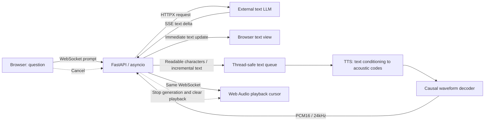
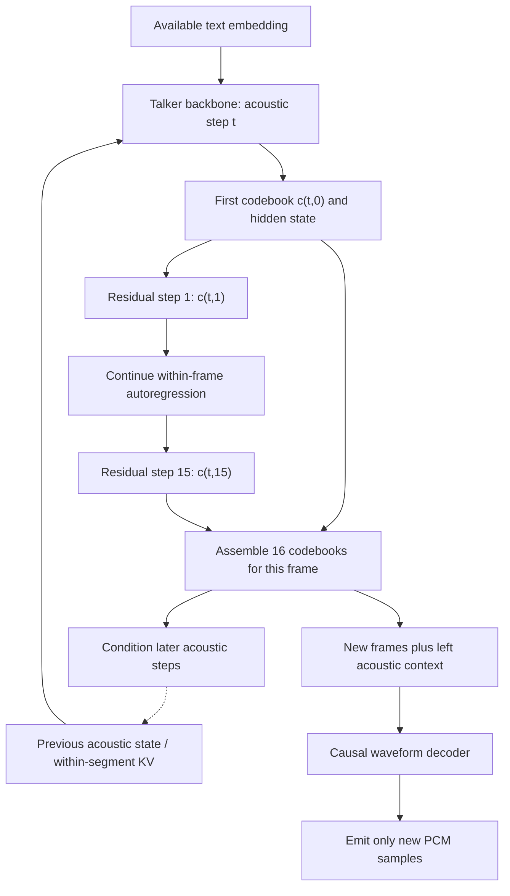
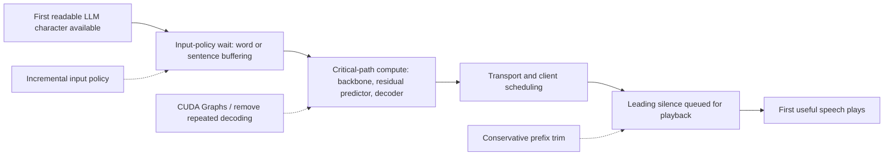
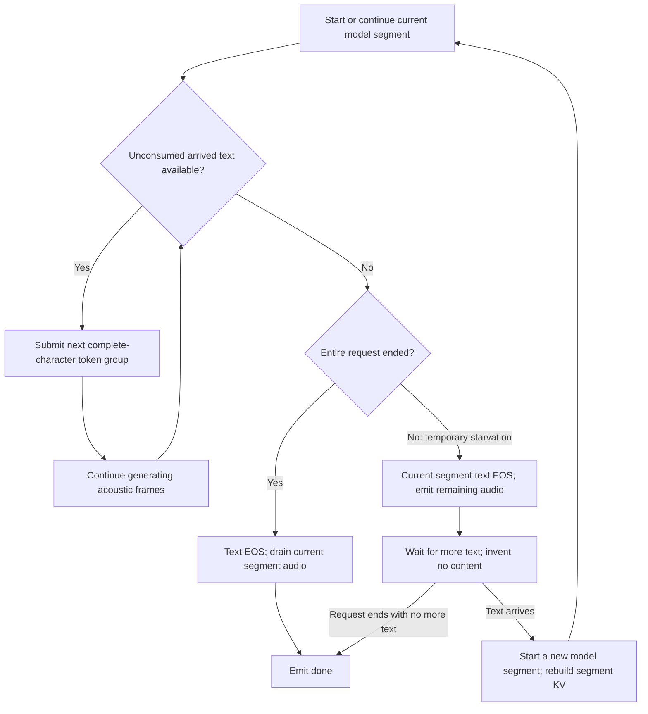

# From the First Readable Token to Speech: Optimizing a Qwen3-TTS Streaming Pipeline

October 21, 2026 · [中文版](optimization.zh.md)

## Abstract

We study a low-latency read-aloud pipeline that connects an independent text LLM to a TTS model. Under the requirement that the first readable character must initiate synthesis without future text, we analyze and optimize the existing `Qwen3-TTS-12Hz-0.6B-CustomVoice` execution path without changing its weights. One synchronized profile attributes approximately 68% of generation time to residual code prediction and 9% to waveform decoding, motivating optimization of residual execution and repeated decoding. The final implementation combines fixed-step CUDA Graphs, bounded left-context decoding, and conservative prefix-silence trimming, with withheld-text trials testing the causal input requirement.

Fixed-text generation decreases from 8.415s to approximately 2.80s. In one browser comparison with identical response text, estimated audible onset decreases from 1,513ms to 550ms. These observations support the approach for the measured single-session workload; they do not establish concurrent-serving performance, perceptual equivalence, or sub-100ms end-to-end latency. Installation and reproduction details appear in the appendix after the architecture, hypotheses, and results.

## 1. Problem formulation: what are we optimizing?

The user wants to hear an answer while the LLM is generating it, rather than after the answer is complete. This creates two objectives:

- **Onset latency:** convert the first known readable character into correct, playable speech as early as possible.
- **Sustained generation:** produce subsequent audio fast enough to keep up with playback and avoid underruns.

First-packet latency cannot stand in for both objectives. An early silent packet does not improve audible onset. A system that starts quickly but generates slower than real time can still stutter.

The constraint is that, once a readable character exists, the adapter must not wait to accumulate a word, sentence, or fixed-size text chunk. A readable character is not an arbitrary tokenizer byte fragment: Chinese text must first form a complete Unicode character. This is an input-policy constraint, not a one-to-one mapping between text tokens and acoustic frames.

### 1.1 Why not start by replacing the model with a smaller one?

The deployed TTS was already the 0.6B variant. Fewer parameters may reduce computation but do not automatically eliminate sentence buffering, Python dispatch, repeated prefix decoding, or generated leading silence. A model change also changes voice, alignment, and streaming behavior, making differences harder to attribute. We therefore first held weights and voice fixed and targeted removable implementation costs. Model replacement remains a future comparison, not a rejected direction.

### 1.2 Why not directly use a Qwen-Omni Talker?

The interface here is a stream of discrete text from an external LLM, not hidden states inside a jointly integrated multimodal model. Calling two components “Talker” or “MTP” does not establish identical conditioning, interfaces, or timing origins. This experiment targets the existing standalone TTS execution path. It neither treats an Omni latency figure as a directly comparable baseline nor claims to reproduce Omni training or architecture.


## 2. Baseline architecture and measurement targets

The experiment uses `Qwen3-TTS-12Hz-0.6B-CustomVoice`, available from the [official Qwen3-TTS repository](https://github.com/QwenLM/Qwen3-TTS). We kept the model and optimized inference and delivery. We did not train a new model or replace it with a Qwen-Omni Talker.

### 2.1 System level: two generative models, not one joint speech model

The external 27B LLM determines what to say; TTS determines how the text already available should sound. The web service connects the two and manages cancellation and playback. LLM text serves both the display and TTS conditioning; TTS is not supposed to invent additional answer content.



*Figure 1. System boundaries. Text ingestion and audio delivery can interleave, but the TTS instance remains single-session. Arrows do not imply concurrent TTS requests.*

### 2.2 Model level: autoregression over time and within a frame

In this configuration, one acoustic frame contains 16 codebook indices. The Talker backbone advances acoustic time, predicting the first codebook and providing a hidden state. A smaller residual predictor fills the remaining 15 codebooks. Together, these indices condition waveform decoding.

There are therefore two distinct dependencies: **temporal dependence between acoustic frames**, and **codebook dependence inside a frame**. We use MTP as shorthand for the latter component. It is not predicting 15 future text tokens or generating 15 future acoustic frames in parallel.



*Figure 2. Dependency schematic, not a full call graph. Backbone KV spans acoustic steps inside a model segment; the residual cache spans the 15 steps inside one frame. They are different states.*

One acoustic frame represents 1,920 samples at 24kHz, or 80ms of **audio content**. This is a coding stride, not a computation time, and it does not mean that one frame is enough to speak a character.

The web service, LLM, and TTS run on the same server. TTS uses one RTX 4090 D; the LLM runs on other GPUs. The TTS service admits one session at a time, so these results exclude multi-user queueing. The backbone and MTP use BF16; the final waveform decoder uses FP32. The environment was `qwen-tts 0.1.1`, `transformers 4.57.3`, and `torch 2.14.1`, with SDPA for the backbone. Main comparisons used Chinese, the Vivian voice, and a warmed service.

### 2.3 Measurement definitions: first packet versus audible onset

The first PCM packet may contain no speech. Server-side generation completion is also different from playback completion. We recorded these separately:

| Metric | Definition |
| --- | --- |
| First text | Send click → first LLM text delta received |
| First PCM | Send click → first binary PCM packet received |
| First non-silent packet | Send click → a PCM packet containing a sample above the silence threshold |
| Estimated audible onset | Estimate from the first non-silent sample's offset, Web Audio scheduling, and available `outputLatency` |
| Generation completion | Send click → server `done` event |
| Playback underrun | Accumulated time by which the playback cursor has fallen behind the audio clock when more audio arrives |

Estimated onset is not a microphone measurement of a physical speaker. An amplitude threshold is not proof that a sample contains correct speech, either. That requires additional content checks.

## 3. Bottleneck analysis and optimization hypotheses

### 3.1 Choose interventions from observations

We first timed residual prediction and decoder calls in a warmed, fixed-text, single-session run, synchronizing CUDA around the measured regions. That run took 8.357s to generate 6.64s of audio. The [baseline profile summary](repro/baseline-profile.json) is included with the code.

| Timed region | Calls | Accumulated time | Share of total |
| --- | ---: | ---: | ---: |
| Residual code prediction | 83 | 5.681s | 67.98% |
| Waveform decoding | 25 | 0.772s | 9.23% |
| Remaining path, by subtraction | — | 1.904s | 22.79% |

The median residual-predictor call took 68.30ms. This is synchronized function-region timing, not a CUDA kernel trace: it does not show that all 68% is CPU dispatch. It identifies where time is spent; changing execution and measuring the result tests how much is removable. The remaining 22.79% cannot all be attributed to backbone computation, since it also includes adaptation, sampling, and Python overhead.

This instrumented run is distinct from the 8.415s end-to-end fixed-text baseline. For throughput, its real-time factor is `RTF = 8.357 / 6.64 ≈ 1.26`, indicating a risk of underruns without additional buffering.

### 3.2 Treat three latency sources separately



*Figure 3. Latency sources and intervention locations. This is a causal decomposition, not a scaled timeline. Generation and playback can overlap, so independently measured boxes should not simply be added. Leading silence can cost both generation steps and playback time; trimming removes only the latter.*

| Observation or constraint | Hypothesis | Intervention | Property to preserve |
| --- | --- | --- | --- |
| Waiting for complete words or sentences is forbidden | Text aggregation itself can delay onset | Consume available characters; close a segment on starvation | Speak the first character before future text arrives |
| Residual prediction accounts for about 68% | Fixed small steps repeatedly enter general-purpose generation, leaving reducible dispatch overhead | Capture the 15 residual steps | Preserve autoregressive dependencies and sampling settings |
| The entire prefix is repeatedly decoded | Already emitted history causes increasing duplicate work | Bounded left context plus graph buckets | Emit neither context nor padding; require no future frames |
| PCM arrives before speech | Generated waveforms contain a low-amplitude prefix | Trim only the request prefix, retaining 40ms | Preserve quiet onsets; do not count silence as speech |

An idealized Amdahl check helps prioritize work: if only the residual region, with share approximately 0.68, were accelerated and everything else remained unchanged, eliminating its cost entirely would cap total speedup at `1 / (1 - 0.68) ≈ 3.1`. This is not a performance forecast. It explains why the residual path is a useful first target, while decoding and playback still need their own analysis.

### 3.3 Why these particular techniques?

The backbone may also benefit from optimization, but this profile does not isolate it as the largest bottleneck. Before changing attention kernels, weight precision, or model size, we chose a high-share, fixed-step residual region that can be checked frame by frame. Dynamic batching primarily targets throughput and utilization; deliberately waiting for more requests or text changes this single-session onset objective, so it was not introduced.

**Workload shape makes CUDA Graphs plausible.** Single-session batch size one and a fixed 15-step residual loop provide stable shapes and execution. Graph replay reduces repeated submission overhead; it does not shrink the model or eliminate within-frame autoregression. If dispatch is not the limiting cost, the gain will be smaller and must be established empirically.

**Bounded context removes duplicate work; buckets reduce execution overhead.** These are distinct motivations. The first bounds how much history is decoded again, while the second maps varying input lengths to a small set of static shapes. With one call per frame, decoding prefixes of length 1, 2, ..., N cumulatively processes `1+2+...+N` input frames; a fixed left window bounds repeated history. This illustrates input redundancy, not a rigorous complexity bound for the complete decoder.

**Silence trimming is an output policy, not model acceleration.** The GPU must still compute the steps preceding useful speech. Trimming prevents the browser from subsequently playing the low-amplitude prefix. Keeping these effects separate avoids mistaking fast first-PCM delivery for fast speech onset.


## 4. Method: interventions at the identified bottlenecks

### 4.1 Input policy: feed incremental text into synthesis

Streaming input and streaming output are different capabilities. Splitting an already completed waveform into packets demonstrates output streaming, not that the model can consume unfinished text.

Our adapter supplies the next text embedding from a queue during audio generation. Unconsumed text can be tokenized together again; tokens already committed to the model are not rewritten. Chinese tokenization requires care around byte fragments: tokenizer offsets are used to commit the pieces covering the first complete character together, rather than dropping part of a character.

When text temporarily runs out, the final implementation:

1. Sends a text-end marker for the current model segment and lets it finish speaking the known content.
2. Continues emitting generated audio instead of blocking playback.
3. Starts another model segment when more text arrives, within the same WebSocket session.

KV state is retained within a segment and rebuilt between segments. This is not an indefinitely continuous Omni Talker state that can wait forever for new text.

If the only available text is “你,” there is nothing else to read once that character finishes. A pause is appropriate. **The system cannot simultaneously avoid waiting, keep producing meaningful speech indefinitely, and never invent missing content.** The first-token requirement means that speaking the known character must not depend on future text; it does not imply zero computation time.

### 4.1.1 State transitions during text starvation



*Figure 4. Default segment policy. Waiting occurs after the known content is completed, not before first-character synthesis. The queue may receive new text while the current segment drains; the next segment consumes it.*


### 4.2 MTP execution: capture the fixed residual loop

Here, MTP refers to the residual code predictor. After the backbone produces the first codebook, this configuration predicts 15 residual codebook tokens. We optimized execution of those fixed steps; we did not remove their autoregressive dependencies or turn them into 15 parallel predictions.

The implementation uses CUDA Graphs with a KV cache:

- Allocate fixed-shape input, position, and output buffers.
- Unroll the 15 steps with their actual dependencies: embeddings at the first step, then the preceding token.
- Retain the captured graph, cache-related tensors, and output buffers for replay.
- Copy each new Talker hidden-state input into the static buffer before replaying.
- Preserve the configured sampling settings: top-k 50, temperature 0.9, and top-p 1.0.

This reduces repeated Python dispatch and general-purpose `generate()` overhead. Fixed shapes alone are insufficient: cache handling, positions, and tensor lifetimes must also be correct.

Passing a random-tensor smoke test was not enough. During startup, the service compares graph greedy outputs against upstream greedy outputs for **32 real Talker inputs**, requiring exact token agreement before accepting requests. This does not establish sample-by-sample equivalence for stochastic generation. CUDA Graph execution can change random-number consumption, so a fixed seed is not a guarantee of identical waveforms.

### 4.3 Waveform decoding: bounded history and static buckets

The previous path repeatedly decoded the entire audio prefix and discarded samples already sent. As a response grew, so did redundant work.

The final path retains 25 frames of left context, decodes that context plus new frames, and uses CUDA Graph buckets of 8, 16, and 32 frames. Inputs larger than the available buckets fall back to ordinary decoding. Each frame represents 1,920 samples at 24kHz: 80ms of audio content, not necessarily 80ms of computation.

Before audible content is detected, decoding is attempted on each frame; afterward, the default cadence is one chunk per four frames. The implementation therefore does not intentionally delay onset to fill a four-frame chunk. First-packet latency, sustained throughput, and playback underrun still need separate measurement.

The output slicing can be summarized as:

```python
sent_frames = samples_sent // 1920
start = max(0, sent_frames - 25)
selected = codes[start:]
wave = decode_with_bucket(selected)
new_pcm = wave[(sent_frames - start) * 1920 : len(selected) * 1920]
```

This is explanatory pseudocode, not a complete implementation. The important properties are that left context is not emitted twice, right padding is discarded, and future text is unnecessary.

BF16 waveform decoding showed noticeable numerical differences across input lengths. We therefore moved only the waveform decoder to FP32 while keeping CUDA Graph acceleration. Across eight startup checks on real frames, the maximum absolute difference from ordinary decoding with the same left context was approximately **0.000653**, below the configured 0.003 threshold.

This is a bounded numerical check, not proof of perceptual equivalence for every sequence length. Changes to the decoder or context window require renewed boundary validation.

### 4.4 Output policy: locate and trim leading silence

For the same fixed input, the original version, the MTP-only optimization, and the decoder-accelerated version all first crossed an absolute waveform amplitude of 0.001 at approximately **365ms into the generated audio**. That places the dominant leading silence for this sample in the generated waveform, rather than in a 365ms browser buffer.

We process only the beginning of each request. Already generated low-amplitude samples are accumulated until an onset is detected; 40ms before that onset is retained, and the earlier prefix is removed. Approximately 325ms was removed in the fixed-text test and 353ms in the browser comparison. Later natural pauses are not trimmed by this rule.

Trimming does not make the model compute speech that does not yet exist. There are two separate gains: generating useful frames sooner and avoiding playback of their preceding silence. The 40ms margin helps preserve quiet onsets, but amplitude gating remains a heuristic that needs coverage across initial phonemes and voices.

### 4.5 Transport and playback: scheduling and cancellation

The server forwards each LLM delta both to the browser and to TTS. Visible text updates do not wait for speech completion. Audio metadata and binary PCM travel over the same WebSocket; the client checks request association before scheduling playback.

The player maintains a continuous cursor instead of starting every packet independently at arrival time:

```javascript
const when = Math.max(cursor, audioContext.currentTime + 0.012);
source.start(when);
cursor = when + buffer.duration;
```

The 12ms margin is a local scheduling choice, not a universal optimum. Stopping clears local audio, discards late packets, cancels remote generation, and releases the single-session lock. Otherwise, the next measurement may include leftover playback or queueing from the previous request.

A later nine-voice selector changes the request's speaker while reusing the streaming and graph paths. Direct intranet HTTP access also exposed an unavailable `crypto.randomUUID()` API. Request correlation now has a timestamp-plus-page-sequence fallback. These IDs are not authentication tokens, and this fallback should not be used for security tokens.

## 5. Experimental results and attribution limits

The browser comparison asked for two sentences about places to walk in Hangzhou. The returned text was identical before and after optimization:

| Metric | Before | After |
| --- | ---: | ---: |
| First text | 697ms | 265ms |
| First PCM | 861ms, including silence | 453ms |
| Estimated audible onset | 1,513ms | 550ms |
| First text → estimated onset | 816ms | 285ms |
| Generation completion | 22.123s | 7.216s |
| Audio duration | 16.80s | 16.45s |
| Accumulated playback underrun | 4,044ms | 0ms |

LLM first-text latency also improved in this pair. Attributing the entire end-to-end difference to TTS would be incorrect. These are individual observations, not p50 or p95 statistics.

A separate TTS test used fixed text and seed 42:

> 你好，欢迎测试。今天我们测试首字朗读和持续音频生成的速度。

| Metric | Original | Final, run 1 | Final, run 2 |
| --- | ---: | ---: | ---: |
| Generation time | 8.415s | 2.803s | 2.794s |
| First non-silent packet | 634ms | 183ms | 189ms |
| Estimated onset | 682ms | 226ms | 231ms |
| Output audio duration | 6.640s | 6.315s | 6.315s |

Generation was approximately three times faster. The duration reduction largely corresponds to removing the roughly 325ms leading prefix. The final fixed-text playback simulation still had approximately 58ms of underrun, so the browser run's zero underrun must not be generalized to all inputs.

### 5.1 What can and cannot be attributed?

The fixed-text comparison removes LLM first-token variation, but the final version changes residual execution, decoder execution/precision, and prefix trimming together. The approximately threefold speedup is therefore a **combined-system result**, not evidence that CUDA Graphs alone provide a threefold gain. Region profiling supports prioritization; it does not replace a complete ablation study.

A stronger attribution experiment would hold hardware, text, sampling, and arrival timing fixed while comparing the ordinary path, residual graphs only, bounded decoding added, decoder graphs added, and finally trimming. Each stage should report onset, full generation time, RTF, and transcript differences. This study did not complete a strictly repeated ablation covering every factor, so no separate causal gain is assigned to each technique.

## 6. Causal-input and content-integrity validation

The most direct test is to withhold the rest of the text. Four trials first supplied “你,” “你,” “我,” and “请,” delaying subsequent text by 2, 2, 5, and 2 seconds. The first non-silent packets arrived at approximately 219, 252, 218, and 218ms.

We extracted **only audio already received before the second text delta arrived** and ran ASR on those prefixes. The recognized results were respectively “你,” “你,” “我,” and “请.” This prevents audio generated after future text becomes available from being counted as evidence of first-token behavior.

The final regression set contained 13 scenarios, including a wait-for-text control, plus four prefix excerpts: 17 ASR comparisons in total.

- Fifteen matched character for character.
- Two contained homophonic substitutions: “先→仙” and “步→不.”
- ASR detected no deletions or insertions.

Three actual LLM-streaming trials also aligned character for character. Two additional complete `/chat` recordings after deployment produced one exact match and one “胜地→圣地” homophonic substitution, with no detected omissions or repetitions. Cancellation and disconnection released the session both during generation and while waiting for text; cancelling and reusing the same connection also passed.

ASR can miss or misclassify pronunciation defects. These are acceptance observations, not a substitute for listening tests or a guarantee of perfect reading on arbitrary input.

## 7. Failed attempts and design tradeoffs

An earlier accelerated candidate generated extra speech. We tried fully greedy backbone generation and then a deterministic tail only after a fragmented request ended. Both introduced omissions, so both were withdrawn. The deployed version preserves the original sampling approach and optimizes execution and decoding instead.

Finishing sooner is not the same as reading everything. Truncating tails, forcing EOS, or changing sampling may improve a timing number while damaging content. Evaluation must retain text, event timing, and complete audio, rather than only first-packet latency.

## 8. Limitations and future experiments

The next checks should cover a wider range of initial phonemes and languages, full reading accuracy across all nine voices, network jitter, long responses, concurrent queueing, cold starts, and p95 latency. The 25-frame window and silence threshold also need broader perceptual validation.

The useful method is to separate packet arrival from audible onset, separate LLM latency from TTS computation, withhold future text to test input streaming, and inspect complete audio before deploying. **This experiment reached audible onset in hundreds of milliseconds; it did not demonstrate sub-100ms end-to-end voice interaction.**

## Appendix A: frameworks, implementation details, and reproduction

A [reproduction directory](repro/README.md) now includes the complete adapter, CUDA Graph implementation, FastAPI service, browser UI, and benchmark clients. Start with the standalone `/ws` text-to-speech test, then connect an LLM through `/chat`.

| Layer | Implementation and observed version |
| --- | --- |
| OS / GPU | Ubuntu 22.04.1, RTX 4090 D 24GB, NVIDIA driver 580.126.20 |
| Python | CPython 3.11.12 |
| Tensor runtime | PyTorch 2.14.1, compiled CUDA 13.0, cuDNN 9.24 |
| TTS package | qwen-tts 0.1.1 |
| Generation | Transformers 4.57.3, accelerate 1.12.0, tokenizers 0.22.2 |
| Serving | FastAPI 0.151.0, Uvicorn 0.54.0, one worker |
| Transport clients | HTTPX 0.28.1, websockets 17.3 |
| Arrays / audio files | NumPy 2.4.6, soundfile 0.14.0 |

The TTS acceleration path uses native PyTorch and Transformers: **no vLLM, SGLang, TensorRT, `torch.compile`, quantization, or new training**. Attention uses SDPA. Graphs accelerate the residual predictor and waveform decoder; the Talker backbone retains ordinary generation. The frontend is plain JavaScript without a build step.

The [full dependency inventory](repro/requirements-observed.txt) records the installed environment, not a freshly resolved lockfile. In particular, torchaudio was 2.11.0 while torch was 2.14.1; these observed versions are not a recommended ABI compatibility pair. A fresh installation of the entire inventory has not been validated, and the kit does not guarantee bitwise-identical environments or waveforms. The model revision was recovered from all 13 cached download metadata records, including both weight files: `85e237c12c027371202489a0ec509ded67b5e4b5`. The commands below pin it.

### Run the experiment in stages

```bash
git clone https://github.com/strike20023/strike20023.github.io.git
cd strike20023.github.io/blogs/qwen3-tts-streaming/repro
uv venv --python 3.11.12 .venv
source .venv/bin/activate
uv pip install -r requirements-observed.txt

hf download Qwen/Qwen3-TTS-12Hz-0.6B-CustomVoice \
  --revision 85e237c12c027371202489a0ec509ded67b5e4b5 \
  --local-dir ./models/Qwen3-TTS-12Hz-0.6B-CustomVoice
export MODEL="$PWD/models/Qwen3-TTS-12Hz-0.6B-CustomVoice"
export CUDA_VISIBLE_DEVICES=0
python -m unittest test_queue -v
FAST_INFERENCE=1 TRIM_LEADING_SILENCE=1 bash run.sh
```

If dependency resolution fails, consult the kit's explanation of the installed inventory, `--no-deps`, and supported torch/torchaudio pairs. Do not silently upgrade inference dependencies and label the result an exact reproduction. Do not remove startup assertions to bypass incompatibility.

In a second terminal with the same environment and directory:

```bash
# Isolate TTS from the LLM; save full WAV files and timestamped JSON events.
python bench.py --mode full --runs 3 --seed 42 --chunk-frames 4 \
  --text '你好，欢迎测试。今天我们测试首字朗读和持续音频生成的速度。' \
  --output outputs/fast-fixed

# Supply only “我”, then withhold the remainder for five seconds.
python bench.py --mode hold --delay 5 --seed 44 \
  --text '我喜欢读书，也喜欢听音乐。' --output outputs/hold
python check_prefix.py outputs/hold
```

Use a separate process for the baseline: stop the server, start `FAST_INFERENCE=0 bash run.sh`, and repeat the benchmark into another output directory. Discard unwarmed runs. This baseline disables both graph acceleration and prefix trimming; add a third run with `FAST_INFERENCE=1 TRIM_LEADING_SILENCE=0` to separate computational gains from silence removal.

For the LLM integration, set `LLM_URL` to the complete OpenAI-compatible chat-completions URL and `LLM_MODEL` to the served model name before starting the server. Supply authentication through `LLM_API_KEY` if needed. Open `http://127.0.0.1:8092/`. A different LLM reproduces the interface, not the original LLM latency. Remove `chat_template_kwargs` if your endpoint rejects this model-specific extension. ASR is not bundled; supply your own prefix/full-waveform transcription. The original evaluation used Qwen3-ASR-1.7B.

### Function-level implementation details

**Text adaptation.** [`install_adapter()`](repro/streaming.py) obtains the installed Talker `forward` with `inspect.getsource`, asserts a known text-embedding source anchor, inserts queue consumption, and binds the resulting method to the instance. It does not edit site-packages. This is intentionally source-version-sensitive. Codec EOS is masked until the current segment has received text EOS; pending token pieces, unconsumed text, and the request-end marker are separate states.

**Residual buffers and positions.** [`install_mtp()`](repro/fast_inference.py) uses static input shape `[1, 2, talker_hidden_size]`. Initial positions are `[0,1]`; subsequent residual step `i` uses `[i+1]` and `generation_steps=i`. `DynamicCache` belongs to the residual sequence within one audio frame, not an indefinitely growing cache across audio frames. Greedy and sampled graphs are captured separately. Sampling performs temperature scaling, top-k filtering, softmax, and multinomial selection on the GPU. The replay result is cloned so the next replay cannot overwrite a result still in use.

**Capture and execution.** The code warms on a separate CUDA stream, synchronizes with the current stream, then captures. A graph references fixed buffers and is not a stateless function. The service consequently enforces a single session and one Uvicorn worker. Multiple inference threads sharing these buffers can overwrite one another's inputs and outputs; this implementation cannot be used unchanged for concurrent throughput benchmarks.

**Decoding and counters.** Codes are shaped `[1, num_quantizers, frames]`. The smallest fitting bucket is zeroed, populated with actual frames, and replayed. `samples_sent` counts model samples before leading-silence removal; emitted PCM may contain fewer samples. Mixing these counters shifts subsequent waveform slices and can cause missing or repeated audio.

**Threads and the event loop.** [`web_chat.py`](repro/web_chat.py) uses HTTPX for asynchronous SSE ingestion and a separate Python thread for GPU inference. `loop.call_soon_threadsafe` transfers inference events to an asyncio queue. This lets text arrival, computation, and delivery overlap; it does not run multiple TTS sessions concurrently.

### Expected validation output

Startup should print `MTP: 32 real Talker inputs matched upstream greedy` and codec comparison logs before accepting requests. The fixed-text benchmark should produce `full-*.wav/json`; the strict-prefix test should produce `hold-0-prefix.wav` containing a recognizable “我”. Neither a successful health check nor a nonempty WAV proves that synthesis is correct.

`bench.py` summary timing begins at `request_start`, after opening the WebSocket. Its playback simulation starts at the first PCM packet and omits the browser's 12ms scheduling margin and physical output latency. Do not treat its simulated onset and the browser display as identical metrics.

*Data note: measurements come from the single-session experiments on October 21, 2026. The article and reproduction directory include serving and benchmark source, but not internal addresses, session logs, or model weights. A fresh installation of the full dependency inventory has not been validated; see the reproduction notes for scope.*

Independent-process check of the public snapshot: fixed-text generation 2.778s, first non-silent PCM 199ms; withheld-text trial first non-silent PCM 217ms, prefix ASR “我”, full transcript aligned. This reused the original installed environment, not a fresh dependency installation. See [machine-readable results](repro/validation-result.json).
